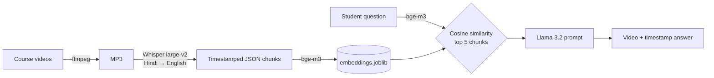

# 🎓 RAG-Based AI Teaching Assistant

Ask a question about a web development course in plain English. The assistant tells you **which video** covers it and **at what timestamp**, so you can jump straight to that part. It runs fully locally: Whisper for transcription, bge-m3 for embeddings, Llama 3.2 for answers, all served by Ollama.

## 🚀 Run it (one command)

Needs [Docker Desktop](https://www.docker.com/products/docker-desktop/).

```bash
docker compose run --rm app
```

On first start Compose launches Ollama, pulls `bge-m3` and `llama3.2` into a volume (~3 GB, one time), then opens the question prompt. Press Enter on an empty line to quit.

Real example from the evaluation run:

```
Ask your question: What is a good LCP score?
Response: A good LCP score should be 2.5 seconds.
Video: SEO and Core Web Vitals in HTML / Number: 6 / Start Time: 3:11 / End Time: 3:15
```

Settings (Ollama URL, model names, top-k) live in `.env`. Copy `.env.example` to change them.

## 💡 How it works



The indexing steps (left side) run once. `embeddings.joblib` is committed, so the Docker app only runs the query side.

| Service | Role |
|---|---|
| `ollama` | Serves bge-m3 and Llama 3.2 |
| `ollama-pull` | One-shot job that pulls the models on first start |
| `app` | `process_incomming.py`: retrieve top-5 chunks, prompt the LLM |

## 📊 Evaluation

30 questions written from the three indexed lectures (#2 First HTML Website, #6 SEO & Core Web Vitals, #10 Video/Audio/Media). Each question has a gold time window: the part of the lecture that answers it. Questions and windows are in [`eval/questions.json`](eval/questions.json).

```bash
python eval/run_eval.py   # needs Ollama with bge-m3 + llama3.2 on localhost:11434
```

| Metric | Result |
|---|---|
| **Retrieval hit@3**: a top-3 chunk is from the gold video and inside a gold window | **27 / 30 (90%)** |
| **Answer supported**: every claim backed by the retrieved passages | **16 yes · 9 partly · 5 no** |

Retrieval is scored automatically. Answer support was graded by hand against the retrieved passages; per-question grades and notes are in [`eval/grades.csv`](eval/grades.csv), raw outputs in [`eval/results.jsonl`](eval/results.jsonl). The LLM output is not deterministic, so a re-run can grade differently.

### Where it fails

1. **Vocabulary mismatch: "How can I quickly generate the HTML boilerplate in VS Code?"** The lecture says "put an exclamation mark" and never says "boilerplate". Retrieval matched on "VS Code" and returned chunks about themes, and the answer cited them. Embedding similarity can't bridge words the speaker never used.
2. **Chunks too small to carry the answer: "What values can the preload attribute take?"** Whisper segments are ~2 seconds long. The top 5 were all sentences that *mention* "preload attribute"; the sentence listing `none / metadata / auto` scored lower. With no values in context, Llama invented them ("the value of the src attribute"). Merging segments into ~30 s windows should fix both this and the many "points to the topic but not the explanation" answers.
3. **LLM ignores a correct retrieval: "How do I zoom in VS Code using the mouse wheel?"** The right chunk (18:28, "editor mouse wheel zoom") was ranked first, yet the answer sent the user to three unrelated timestamps as numbered "steps". A 3B model follows the prompt loosely; a stricter prompt ("cite only the chunk that answers the question") or a larger model is the next thing to try.

## 🔁 Rebuilding the index (optional)

Only needed for new videos. Requires local Python, `ffmpeg`, `openai-whisper` and Ollama. Scripts are in `Steps before running process_incoming.py/`; run them from the repo root:

```bash
python "Steps before running process_incoming.py/video_to_mp3.py"    # videos/ → audios/
python "Steps before running process_incoming.py/mp3_to_json.py"     # audios/ → jsons/
python "Steps before running process_incoming.py/preprocess_json.py" # jsons/ → embeddings.joblib
```

Run the assistant without Docker: `pip install -r requirements.txt && python process_incomming.py`

## 🔧 Tech stack

| Component | Tool |
|---|---|
| Transcription | Whisper large-v2 (Hindi → English) |
| Embeddings | bge-m3 via Ollama |
| LLM | Llama 3.2 (3B) via Ollama |
| Retrieval | Cosine similarity (scikit-learn) over a pandas DataFrame |
| Packaging | Docker Compose |

## 👤 Author

**Sufyan** — [github.com/sufyan1105](https://github.com/sufyan1105)
